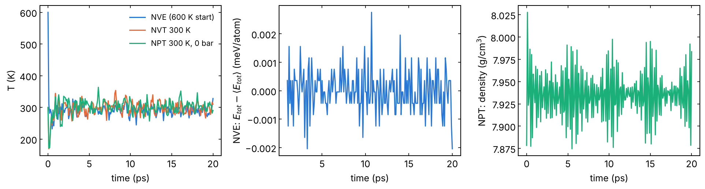

# 02 · MD in the NVE, NVT and NPT ensembles

Molecular dynamics integrates Newton's equations with a timestep of ~1 fs.
The ensemble says what is kept constant: energy (NVE, no thermostat),
temperature (NVT, a thermostat exchanges heat), temperature and pressure
(NPT, the cell changes too). These three are the building blocks of every
other template. You get a trajectory, thermodynamic averages and a
restart file.

| Input | What it does | Check |
|---|---|---|
| `nve.in` | velocities at T, then `fix nve` | total energy constant (drift ≪ fluctuations of pe) |
| `nvt.in` | `fix nvt` at T, Tdamp = 100 dt | temperature fluctuates around T |
| `npt.in` | `fix npt` at T and P, Pdamp = 1000 dt | averages of T, P, density over the second half (`npt_averages.txt`) |

All on `Fe_bcc.data` (250 atoms of bcc Fe), 20 ps each.

```bash
sbatch job.sh nvt.in
```

## Notes

- **Initial temperature.** `velocity create T` on a perfect crystal: half
  of the kinetic energy goes into potential energy and T settles near
  T/2 (in `nve.in`, 600 K gives ~280 K).
- **Fluctuations.** In small systems T and P fluctuate a lot: σ(T)/T ≈
  √(2/(3N)), 5 % at 250 atoms (measured below: 4.5 % in NVE, 5.7 % in
  NVT). Pressure jumps by ±1 GPa here: average it, never read one line.
- **Cell coupling in NPT**: `iso` (cubic, liquid, amorphous), `aniso`
  (non-cubic crystals), `x ... y ...` for slabs with vacuum, `z` for a
  film between fixed lateral cells. The comment block in `npt.in` gives
  the syntax.
- **Tdamp/Pdamp** too small (e.g. 10 dt) make the temperature or the cell
  oscillate; too large equilibrate slowly. 100 dt and 1000 dt are the
  usual values.

## Local check (reduced settings)

`pair_style eam/fs` with `Fe_mm.eam.fs` (Mendelev EAM, LAMMPS
`potentials/`), serial CPU build, the inputs as they are otherwise:

- NVE (600 K start, 20 ps): after 2 ps T = 291 ± 13 K; total energy
  −1011.0945 eV at step 0, then constant within 1.2 meV (no drift).
- NVT (300 K): after 2 ps T = 299 ± 17 K.
- NPT (300 K, 0 bar), averages of the last 10 ps: T = 301 K, P = 64 bar,
  a = 14.2953/5 = 2.8591 Å (0 K, `01_minimize`: 2.8553 Å), ρ = 7.936
  g/cm³.



Temperature in the three runs; total energy of the NVE run around its
mean (after 1 ps); density in the NPT run. Logs and averages in
`reference/`.
