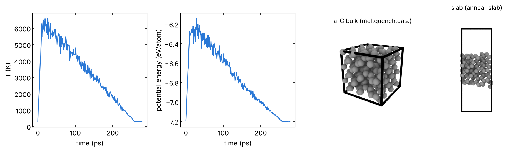

# 03 · Melt-quench: amorphous bulk and its surface

Amorphous solids (a-C, a-SiNₓ, oxides, glasses) are made by melting a
starting structure at the target composition and density, equilibrating
the liquid and cooling it fast enough that it does not crystallize. The
starting structure comes from `structures/03_amorphous`. You get an
amorphous bulk; `anneal_slab.in` then opens a vacuum gap and anneals the
two new surfaces.

## 1. Bulk: `meltquench.in`

Stages, all NVT (fixed cell, so the density stays the one you built):

| Stage | Default | Comment |
|---|---|---|
| heat T0 → Tmelt | 300 → 6000 K in 10 ps | Tmelt well above the melting point *of the potential* |
| melt at Tmelt | 20 ps | the liquid must forget the crystal: check the RDF |
| quench Tmelt → T0 | 25 K/ps (228 ps here) | slower = more ordered, lower energy |
| anneal at T0 | 20 ps | |
| NPT at T0, P (optional, `do_npt 1`) | 50 ps | lets the potential choose the density |

```bash
sbatch job.sh meltquench.in     # needs aC_start.data (216 C at 3.0 g/cm3)
```

`aC_start.data` was built with
`python ../../structures/tools/density.py ../../structures/bulk/C_diamond.cif --repeat 3 3 3 --target 3.0 -f lammps-data --specorder C -o aC_start.data`.
Each stage writes a restart (`1_heat.restart`, ...): a different quench
rate can start from `2_melt.restart`, with an input that begins with
`read_restart` and gives the pair style and the fixes again
(`../00_basics/02_input_anatomy.md`, "Restart files").

The group runs used: diamond-like C, 9000 K melt and two quench steps to
300 K in ~4 ps (CHGNet); SiN, 5000 K melt and 200 ps quench, optionally
the last part in NPT (MACE). Quench rates of MD (10¹²-10¹⁴ K/s) are
orders of magnitude faster than in experiments: compare the structure
(density, coordination, RDF) with experiments, and report the rate.

## 2. Surface: `anneal_slab.in`

```bash
sbatch job.sh anneal_slab.in    # needs meltquench.data from step 1
```

`change_box` adds `vacuum` Å along z: the bulk is cut at the z boundary,
giving two free surfaces. Then heat to Ta (1500 K), hold, cool, minimize.
`set group all image 0 0 0` clears the image flags inherited from the
bulk run; without it the slab looks cut in two in the unwrapped
trajectory (`../troubleshooting.md`, "Silent problems").

## Checks

- Liquid: mean square displacement growing linearly, RDF without crystal
  peaks.
- Final structure: density, coordination numbers, RDF, bond angles
  (`structure.py` in `../analysis/`). For carbon: sp³ fraction (fourfold C).
- Energy vs quench rate: two rates give an idea of how far from
  convergence the structure is.

## Local check (reduced settings)

`pair_style tersoff` with `SiC.tersoff` (LAMMPS `potentials/`, C
parameters) in place of the MLIP, 216 atoms, the inputs as they are
otherwise; 93 s (`meltquench.in`) and 20 s (`anneal_slab.in`) on one CPU
core.

- `meltquench.in`: in the anneal stage T = 301 K and P = −10.4 GPa at
  3.0 g/cm³ (the potential would like a higher density); 91 % threefold and
  9 % fourfold C (cutoff 1.85 Å). The NPT stage (tested separately with a
  570 K/ps quench and 20 ps NPT) brings the density to 3.43 g/cm³.
- Timestep at 6000 K: in the melt (NVT, 9 ps from `1_heat.restart`)
  `econserve` drifts by 190 eV with 1 fs, 13 eV with 0.5 fs and 0.8 eV
  with 0.25 fs (216 atoms). The thermostat keeps T right and hides it:
  check `econserve` with your MLIP and lower the timestep for the hot
  stages if it drifts.
- `anneal_slab.in`: the 11.28 Å bulk becomes a 12.3 Å thick slab in a
  31.28 Å cell, centred in z; 13 % twofold, 81 % threefold, 6 % fourfold C.



Temperature and potential energy along the stages, the amorphous bulk and
the annealed slab. Tersoff carbon is a poor model of a-C: these numbers
check the input, not the material. Logs in `reference/`.
