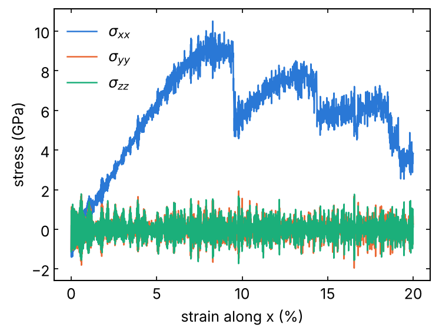

# 04 · Uniaxial deformation (stress-strain)

The cell is stretched or compressed along x at constant engineering strain
rate, while the barostat keeps y and z at zero pressure (uniaxial
stress). You get the stress-strain curve: Young's modulus from the initial
slope, yield or fracture from the maximum. From the group SiN compression
runs.

```bash
sbatch job.sh uniaxial.in      # Fe_bcc.data
```

1. NPT at T and 0 bar (`aniso`, 20 ps); the final lx is L0.
2. `fix deform ... x erate` with `npt ... y 0 0 z 0 0`: strain
   ε = (lx − L0)/L0 and stresses σ = −p/10⁴ (GPa, positive = tensile)
   written every 100 steps to `stress_strain.txt`.

Settings: `srate` in 1/s (negative for compression), converted to 1/ps
(`erate`, metal units); `strain` the final strain. Rates of 10⁸-10¹⁰ 1/s
are typical of MD and much faster than experiments: check the modulus at
two rates.

## Notes

- `thermo_style` must contain `press` when variables use `pxx`
  (otherwise: `ERROR: Thermo keyword pxx in variable requires thermo to
  use/init press`, met while writing this template).
- `remap x` moves the atoms with the cell; without it only the box
  changes.
- Fracture of a perfect crystal needs very high stress: real materials
  break at defects. Put the defect (notch, grain boundary, void) in the
  structure if you want that.

## Local check (reduced settings)

`pair_style eam/fs` with `Fe_mm.eam.fs`, 250 atoms, tension along [100] at
10⁹ 1/s to 20 % strain (200 ps), the input as it is otherwise: L0 = 14.235
Å; σxx ≈ 6.1 GPa at 5 % (initial slope ≈ 120 GPa), maximum 9.7 GPa at 8 %,
then yield (σxx drops to 4-8 GPa). σyy, σzz stay at 0 ± 1 GPa. 72 s on
one core. Log and curve in `reference/`.


