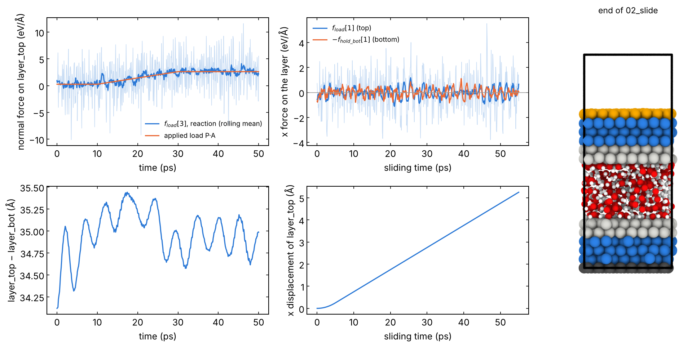

# 05 · Sliding interface at constant load

Two slabs with molecules (or a film) in between, the top slab pushed down
by a normal load and slid along x: the standard non-equilibrium MD (NEMD)
tribology setup. The friction force is the lateral force on the driven
layer. You get friction vs time, the gap, the temperature of each region
and trajectories for velocity and density profiles. The layout is that of
the group runs on MXenes and ZDDP on iron.

The system and its groups come from `structures/04_sliding_interface`
(`interface.py`): `Fe_water_Fe.data` (Fe(110) / 191 H₂O + 10 O₂ / Fe(110),
1457 atoms) and `Fe_water_Fe.groups.lmp`.

| Group | Role |
|---|---|
| `layer_bot` | fixed: `setforce 0 0 0`, no integrator |
| `thermo_bot`, `thermo_top` | Nose-Hoover at T, temperature without the COM motion (`temp/com`) |
| `surf_bot`, `molecules`, `surf_top` (`intercalate`) | NVE: the interface evolves freely |
| `layer_top` | normal force on each atom (`addforce`); in 01 NVE, in 02 x velocity imposed (`fix move`), y and z free |

## 1. Load: `01_load.in`

```bash
sbatch job.sh 01_load.in
```

0. Minimization under the small load P0 (removes overlaps of the stacked
   structure).
1. Thermalization at P0 in blocks of `t_block`: the velocities of `mobile`
   are re-drawn at the start of each block, which removes the heat
   released when the surfaces settle on the molecules (only the
   thermo layers have a thermostat).
2. Load ramp P0 → P (linear in the step).
3. Hold at P: wait until the gap (`v_gap`) is stable.

The force per atom is computed in the input from P, the cell area and the
number of atoms of `layer_top`, so P can be changed there. Output columns:
`f_load[1]`, `f_load[3]` are the x and z forces of the system on
`layer_top` (eV/Å, sum over the group): `f_load[3]` averages to the load,
P·A, at equilibrium.

## 2. Slide: `02_slide.in`

```bash
sbatch job.sh 02_slide.in       # when 01_load has finished (load.restart)
```

`layer_top` moves along x at `v` (10 m/s = 0.1 Å/ps), after a linear
acceleration over `t_acc`; z is free under the load, so the gap can
change. `reset_timestep 0` at the start: time 0 = start of sliding,
sliding distance = v t (minus the acceleration).

- Friction force: `f_load[1]` (eV/Å). Shear stress τ = −f_load[1]/(lx ly)
  × 160.2 GPa (the minus: the force of the system on the top layer opposes
  the motion). Friction coefficient μ = τ/P.
- Average only the steady state: discard the first part (run-in), use
  block averages for the error (`friction.py` in `../analysis/`; velocity
  and density profiles: `vprofile.py`, `zprofile.py`).
- `fix move` integrates the NULL components like `fix nve` and must be the
  only integrator on `layer_top`.

## Variants

- **Brake or velocity ramps**: redefine `variable vx` (e.g.
  `v_vA*(1-(step-s1)/n)` to stop in n steps), as in the group SiN runs.
- **Rigid top layer** (the outer layer moves as one body): `fix rigid/nve
  single` on `layer_top` with `addforce`, and the sliding on a second
  group below it (`slide_top`): the scheme of `06_indentation/02_scratch.in`.
- **Lift-off or pull-off**: drive `layer_top` up with `fix move linear 0 0
  vz units box` after removing the load.
- **Density profiles during the run**: `compute chunk/atom bin/1d z lower
  0.5` + `fix ave/chunk ... density/number` for each species group.
- **No molecules**: drop `molecules` and `temp_mol` (groups file from
  `interface.py` without `--middle`).

## Local check (reduced settings)

The data file as it is, with `pair_style hybrid eam/fs lj/cut 6.0`: Fe-Fe
EAM (Mendelev), all other pairs Lennard-Jones (ε = 0.03 eV, σ = 2 Å among
O and H; ε = 0.05 eV, σ = 2 Å with Fe). The "water" is a non-bonded LJ
liquid: not physical, it checks the mechanics of the inputs. Times reduced:
t_therm 10, t_block 5, t_ramp 20, t_hold 20 ps; t_acc 5, t_slide 50 ps.
Serial CPU build, about 4 min for each input.

- 01: minimization, 2 thermalization blocks, ramp to 1 GPa, hold. During
  the hold `f_load[3]` averages to 2.62 eV/Å against P·A = 2.61 eV/Å, and
  the gap is 34.9 ± 0.2 Å; thermostatted layers at 300 ± 20 K.
- 02: `layer_top` moves at 0.1 Å/ps after the 5 ps acceleration; the gap
  stays at 34.6-35.1 Å. The friction force is zero within the noise for
  this LJ liquid (`f_load[1]` −0.01 eV/Å, `−f_hold_bot[1]` −0.03 eV/Å on
  average after 10 ps): the two layers give the same average, as they
  should in steady state.



Left: load stage (normal force on `layer_top`, raw and rolling mean, and
the applied load; distance between the outer layers). Middle: sliding
stage (x force on the top and bottom layers, displacement of `layer_top`).
Right: groups at the end of the sliding (colours as in
`structures/04_sliding_interface`). Logs (with the modified lines) in
`reference/`.
