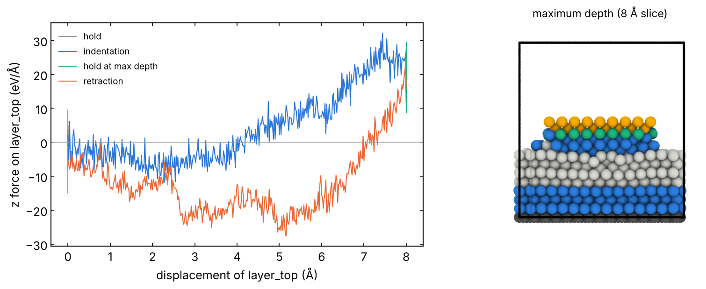

# 06 · Indentation and scratch with a tip

A tip (single asperity) pressed into a slab and pulled out
(nanoindentation), or slid on it under a constant load (scratch). You get
the load-displacement curve, the friction force of a single contact and
the damage (plastic zone, transfer of atoms, wear). From the group runs of
diamond tips on SiN.

The system, built with the tools of `structures/05_tip` (the example
there is a C tip; here an Fe one): `Fe_tip_on_Fe.data`, an Fe hemisphere
(R = 12 Å, 333 atoms) on Fe(110) (1800 atoms), 4 Å apart, and
`Fe_tip_on_Fe.groups.lmp`. To adapt it: your data and groups files,
then `model`, `elements`, `T`, `area` (πR² printed by `tip.py`), depth,
load and speed in the settings blocks. Built with:

```bash
python ../../structures/tools/tip.py ../../structures/bulk/Fe_bcc.cif --radius 12 -o Fe_tip.extxyz
python ../../structures/tools/slab.py ../../structures/bulk/Fe_bcc.cif --miller 1 1 0 --layers 8
python ../../qe/tools/ortho_cell.py Fe_bcc_110_t0.extxyz --square 36 -o Fe110_36.extxyz
python ../../structures/tools/interface.py Fe110_36.extxyz --top Fe_tip.extxyz --isolated-top \
       --fixed 2 --thermo 6 --top-fixed 2 --top-slide 2 --top-thermo 5 --gap 4.0 \
       --specorder Fe -o Fe_tip_on_Fe.data
```

Groups of the tip, from the flat face down: `layer_top` (2 Å), `slide_top`
(2 Å), `thermo_top` (5 Å), `surf_top` (the apex). Slab: `layer_bot` fixed,
`thermo_bot` thermostat, `surf_bot` NVE.

## 1. Indentation: `01_indent.in` (displacement control)

```bash
sbatch job.sh 01_indent.in
```

`layer_top` is moved as a block by `fix move linear` (no other
integrator): held for `t_therm`, down by `depth` at `v` (10 m/s), held for
`t_hold`, back up by `depth`. The rest of the tip follows by its own
dynamics. Output: `v_ztip` (height of `layer_top`) and `v_fztip`
(`fcm(layer_top,z)`, the z force on it, eV/Å; positive = the slab pushes
the tip up). Plot `v_fztip` against the displacement for the load curve.

## 2. Scratch: `02_scratch.in` (load control)

```bash
sbatch job.sh 02_scratch.in
```

`layer_top` is a rigid body (`fix rigid/nve single`) with `addforce` on its
atoms: the load P on the flat-face area (`area`, πR² printed by `tip.py`).
Stages: thermalization at zero load, load ramp, hold, sliding of
`slide_top` along x at `v` (after `t_acc`), its y and z free. Friction:
`v_fxtip` = `fcm(slide_top,x)`, negative when it opposes the motion.

The nominal pressure on the flat face is not the contact pressure, which
is much higher and changes as the contact grows: report the total normal
force (`load:` line of the log) together with P.

## Notes

- Retraction of a metal tip from a metal surface: the force becomes
  negative (adhesion), and atoms can be pulled out of the slab.
- `WARNING: Cannot count rigid body degrees-of-freedom before bodies are
  fully initialized`: printed once at the start with `fix rigid`; it does
  not affect the run.
- The slab must be much wider than the contact: the plastic zone and the
  pile-up should not reach the periodic images of the tip.

## Local check (reduced settings)

`pair_style eam/fs` with `Fe_mm.eam.fs` (Mendelev EAM), serial CPU build.

- `01_indent.in`, as it is (20 + 80 + 20 + 80 ps, 8 min): `v_fztip` from
  about −3 eV/Å (attraction before contact) to +24 eV/Å at 8 Å of travel,
  relaxing to +21 eV/Å in the hold; at the start of the retraction it
  becomes −23 eV/Å (adhesion) and goes back to −8 eV/Å at the end.
- `02_scratch.in` with t_ramp 10, t_hold 5, t_acc 5, t_slide 20 ps: load
  2 GPa on 452.4 Ų = 5.65 eV/Šin total; the tip jumps into contact
  already at zero load (Fe-Fe attraction across the 4 Å gap: `v_ztip`
  from 29.0 to 24.2 Å in 6 ps), sinks to 23.7 Å under the load, then
  `slide_top` advances at 0.1 Å/ps.



Left: z force on `layer_top` vs its displacement in the four stages of
`01_indent.in` (negative = the tip is pulled towards the slab). Right: an
8 Å slice through the tip axis at the maximum depth, coloured by group
(as in `structures/05_tip`). Logs in `reference/`.
