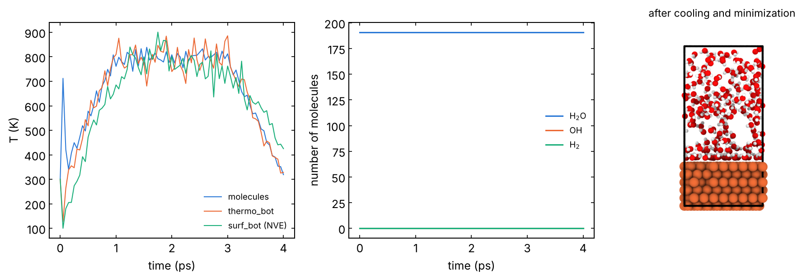

# 07 · Molecules on a surface at high temperature

A slab in contact with molecules (water, O₂, lubricant additives) is
heated, held at high temperature and cooled: the reactions of the
molecules with the surface (oxidation, dissociation, hydrolysis) happen in
the hold. The molecules are counted during the run with coordination
numbers. You get the reacted surface and the number of intact molecules
and products vs time. From the group runs of Fe oxidation and MXene
hydrolysis.

The system: `Fe_water.data`, Fe(110) (432 atoms) with 191 H₂O and 10 O₂
above it, groups in `Fe_water.groups.lmp`, built in
`structures/04_sliding_interface` with:

```bash
python ../tools/interface.py Fe110.extxyz --no-top --middle water.extxyz --vacuum 15 \
       --specorder Fe O H -o Fe_water.data
```

```bash
sbatch job.sh highT.in
```

- `boundary p p f` and `fix wall/reflect zlo EDGE zhi EDGE`: the molecules stay in
  the box (z is not periodic, so the bottom of the slab does not see the
  molecules through the periodic image).
- Thermostats on `thermo_bot` and on `molecules`; `surf_bot` is NVE, so the
  reacting surface is not perturbed by a thermostat. `layer_bot` is fixed.
- Stages: heat T0 → Th (`t_heat`), hold (`t_hold`), cool (`t_cool`),
  optional minimization (`do_min`). When a thermostat is redefined with
  the same ID, its `fix_modify` line is repeated.

## Molecule counts

```
compute   cn_OH atom_O coord/atom cutoff 1.2 group atom_H     # H around each O
variable  is_h2o atom "type==v_tO && c_cn_OH==2"
compute   n_h2o all reduce sum v_is_h2o                         # -> thermo column c_n_h2o
```

`c_n_h2o`, `c_n_oh`, `v_n_h2` in the thermo output: water, OH (on the
surface or free), H₂. Set `tO` and `tH` to the types of O and H in your
data file. The cutoffs (1.2 Å O-H, 0.9 Å H-H) must sit between the bond
length and the next neighbour: check them on the O-H and H-H RDF of your
system. Thermal stretching makes a molecule flicker between two counts
near a cutoff that is too tight. Same pattern for CH₄ or NH₃ (counts of H
around C or N).

## Local check (reduced settings)

ReaxFF (`ffield.reax.Fe_O_C_H`, LAMMPS `potentials/`) in place of the
MLIP. ReaxFF needs `units real` and charges, so the check input differs
more than the others: `atom_style charge` (the data file converted with
zero charges), `fix qeq/reaxff`, timestep 0.25 fs, the times in fs.
Serial CPU build, 13-15 steps per second for 1025 atoms.

Times: t_heat 1, t_hold 2, t_cool 1 ps (19 min), then the minimization
(14 min). The stages run as intended: in the hold (set 800 K) the
molecules stay between 741 and 839 K and `thermo_bot` between 681 and
886 K; after the cooling 319 K (molecules) and 329 K (`thermo_bot`), while
`surf_bot`, not thermostatted, is still at 425 K. The spike of the
molecule temperature in the first 0.05 ps is the packed water relaxing
(no minimization before the MD). The counts stay at 191 H₂O, 0 OH, 0 H₂:
no reaction in 2 ps at 800 K (production holds are hundreds of ps). The
final minimization stopped with `linesearch alpha is zero` after 2240
iterations (force two-norm 777 → 18 kcal/mol/Å): check `Force max
component` in the minimization statistics of the log before using the
minimized structure. Log in `reference/`.



Temperatures of the three groups (left; heat, hold, cool), molecule
counts (middle; OH and H₂ stay at 0) and the system after cooling and
minimization (right).
