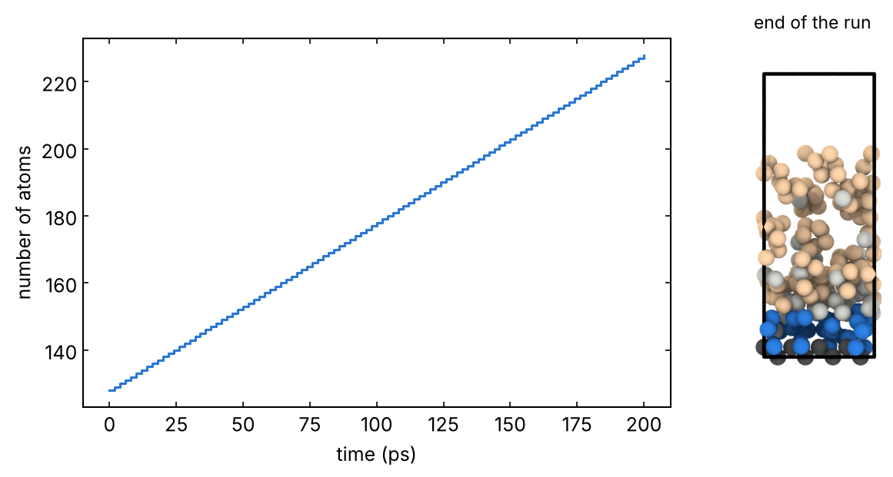

# 08 · Deposition

Atoms or molecules are inserted above a surface at regular intervals and
shot at it, as in CVD or PVD growth; the film grows atom by atom. In
cycles, the atoms that bounced back or desorbed (free atoms high above the
surface) are deleted, so that they do not accumulate under the top wall.
You get the grown film and the sticking statistics (inserted vs deleted).
From the group LPCVD/PECVD runs of SiNₓ (SiH₄ and NH₃, removal of H₂ and
N₂).

The test system: `Si001.data`, Si(001) with 8 layers (128 atoms) and 30 Å
of vacuum, groups in `Si001.groups.lmp`. Built with:

```bash
python -c "from ase.build import diamond100; from ase.io import write; write('Si001.extxyz', diamond100('Si', size=(4,4,8), a=5.431, vacuum=10))"
python ../../structures/tools/interface.py Si001.extxyz --no-top --fixed 2 --thermo 4 --vacuum 30 --specorder Si -o Si001.data
```

```bash
sbatch job.sh deposition.in
```

- `fix deposit`: `ncycle × nper` insertions of type `type_dep`, one every
  `every` steps, in a 5 Å slab `zin` Å above the surface, with velocity
  `−vin` along z. The thermal speed √(3k_BT/m) is 9.4 Å/ps for Si at 1000 K;
  higher speeds model energetic (PVD, ion) deposition.
- Molecules: `molecule` command with a molecule file and `mol` in `fix
  deposit` (commented lines in the input; molecule file format in the
  LAMMPS manual, command `molecule`).
- Every cycle (`nper` insertions): `delete_atoms group free compress no`,
  where `free` is a dynamic group of atoms with no neighbour within `rcut`,
  more than 5 Å above the initial surface and moving up (`vz > 0`). Without
  the velocity condition the atom inserted last, still on its way down,
  is deleted too (it happened in the first version of this template).
  `compress no` keeps the IDs: by default `delete_atoms` re-assigns the IDs
  of all atoms, so the frames of the trajectory no longer match by ID.
  `id next` in `fix deposit` does the same for new atoms: by default a new
  atom gets the highest current ID + 1, the ID of a deleted atom if that
  one was the last inserted. (Added after the local check below.)
  For products such as H₂, use the coordination with the commented lines
  (`07_reactive` counts them the same way).
- Reflecting walls at both z faces (`boundary p p f`): an atom that crosses
  a non-periodic face is lost and the run stops (`ERROR: Lost atoms`, met
  with only the top wall).
- Size: the film grows by about N/(n A) (8.5 Šfor 100 Si on 236 Ų).
  The insertion region must stay above it (otherwise `WARNING: One or
  more particle depositions were unsuccessful` and fewer atoms are
  inserted) and inside the box: `zin` + 5 Å must fit in the vacuum of the
  data file (30 Å here), else `ERROR: Deposition region extends outside
  simulation box`.
- The loop: `variable icycle loop`, `label`, `run`, `next icycle`, `jump
  SELF cycle`. The `next` line is what ends it: without it the loop runs
  until the walltime and the final `write_data` is never reached.

The `atoms` column of the thermo output gives the number of atoms; the
log reports `Deleted N atoms` at each cycle.

## Local check (reduced settings)

`pair_style tersoff` with `Si.tersoff` (LAMMPS `potentials/`), the input
as it is otherwise (10 cycles of 10 insertions, 200 ps), serial CPU build,
66 s: 100 atoms inserted, 1 deleted (it bounced back, in the last cycle),
227 atoms at the end; thermostatted layer between 790 and 1390 K (48
atoms: large fluctuations). Log in `reference/`.


