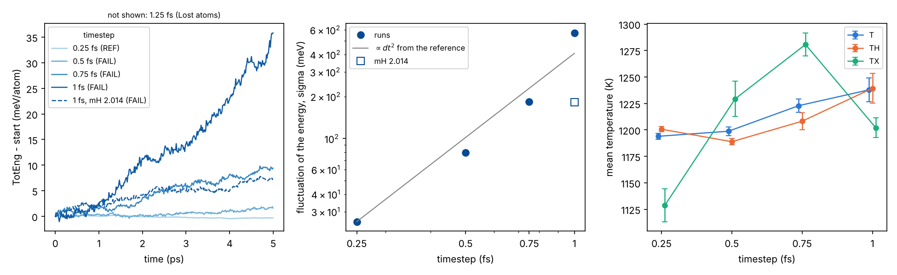
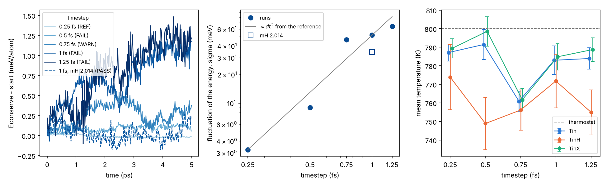

# 09 · Timestep test with H

H is the lightest atom, so the stretching of X-H bonds is the fastest
motion in our systems. The period follows from the experimental
fundamental wavenumber, τ = 1/(c ν̃) (wavenumbers from the
[NIST CCCBDB](https://cccbdb.nist.gov)):

| bond | molecule, mode | ν̃ (cm⁻¹) | period (fs) | steps per period at 1 fs / 0.5 fs |
|---|---|---|---|---|
| H-H | H₂ | 4161 | 8.0 | 8 / 16 |
| O-H | H₂O, asym. stretch | 3756 | 8.9 | 9 / 18 |
| N-H | NH₃, deg. stretch | 3444 | 9.7 | 10 / 19 |
| C-H | CH₄, deg. stretch | 3019 | 11.0 | 11 / 22 |
| Si-H | SiH₄, deg. stretch | 2191 | 15.2 | 15 / 30 |

Classical force fields run 1 fs with H because the X-H bonds are
constrained (SHAKE), e.g. Ewen et al., Materials 9, 651 (2016),
doi:10.3390/ma9080651. A reactive MLIP cannot constrain them, so the
timestep has to be checked with the model and the system. In sliding and
indentation runs only the outer layers are thermostatted: an integration
error becomes heat at the interface, where the H is.

The test uses a property of velocity Verlet: the energy is not exactly
conserved, it fluctuates around a constant, and the RMS of the
fluctuations grows as dt² (Merz and Shirts, PLOS ONE 13, e0202764 (2018),
doi:10.1371/journal.pone.0202764). From the smallest dt up: while σ(E)
follows dt² and the drift, the temperatures and the H chemistry stay as
at the smallest dt, the timestep is fine.

## Files

| File | What it does |
|---|---|
| `equil.in` | equilibrates the system at T (Langevin on all atoms that move, 0.25 fs), writes `equil.restart` |
| `nve.in` | NVE from `equil.restart` at timestep `dt`: energy, temperatures of H and of the other atoms, largest H step, free H and H₂, H-X and H-H distributions |
| `layout.in` | the layout of `05_sliding` at constant load, without sliding: fixed layer, Nose-Hoover layers, NVE in between; `econserve` and the temperatures of the inner (NVE) region |
| `job_scan.sh` | Slurm array, one timestep per GPU: 0.25, 0.5, 0.75, 1.0, 1.25 fs |
| `check_dt.py` | reads the logs, compares each dt with the smallest, writes a table, `<out>.csv` and `<out>.png` |

## How to run (Leonardo)

Set `model`, `elements`, `tH` (type of H) and the start file in the
inputs, the account in `job.sh` and `job_scan.sh`.

```bash
# A. any system: bulk, film between two fixed layers, gas
#    (equil.in: start, fixed, T; e.g. fixed "layer_bot layer_top")
jid=$(sbatch --parsable job.sh equil.in)
sbatch --dependency=afterok:$jid job_scan.sh nve.in
python check_dt.py "nve_dt*.log"

# B. interface at load, from the restart at the end of your load stage
#    (layout.in: start, group names, P; rigid 1 if layer_top is a rigid body)
sbatch job_scan.sh layout.in 700          # thermostats at 700 K
python check_dt.py "layout_dt*.log"

# H with the mass of D at 1 fs (array task 3 = 1.0 fs), next to the others
sbatch --array=3 job_scan.sh nve.in 300 2.014
```

- Only `dt`, `T`, `mH` and `tag` can be set from the command line (index
  variables); the rest is in the settings block of the input.
- `equil.in` (5 ps at 0.25 fs) may not fit the 30 min of the debug queue
  for a large system: delete the `--qos` line of `job.sh`.
- Cost: `t_run`/dt steps per run (5 ps: 20000 steps at 0.25 fs, 5000 at
  1 fs); the `ns/day` column of `check_dt.py` gives the speed of each dt.
- `check_dt.py` needs numpy and matplotlib (the shared env has both).

## Cases worth testing

Take the cases at the edge of what you run in production:

| Case | Why it is demanding | Test |
|---|---|---|
| interface at the highest load and T (MXene-OH/Fe at 5 GPa and 700 K, SiN/diamond with H and OH at 800 K) | H squeezed at the interface, NVE region | `layout.in` from the restart of the load stage |
| water or OH confined at high T (MXene hydrolysis at 800-1000 K) | O-H stretch, H transfer | `nve.in`, fixed `"layer_bot layer_top"`, T as in production |
| gas-phase H species (CVD: SiH₃, NH₂, H₂ at 1000-1200 K) | isolated molecules, nothing damps the error; H₂ is the fastest mode | `nve.in` on a box from `structures/tools/packmol.py`, e.g. `python packmol.py SiH3 NH2:20 H2:20 --box 30 30 30 --density 0.05` |
| stages at high T with H (annealing, melt-quench of H-containing films) | large amplitudes, bonds breaking | `nve.in` at that T |
| mass of D for H (`mH 2.014`) | X-H periods longer by about √2: 1 fs may pass where H needs 0.5 fs | any of the above with `-var mH 2.014` |

## Reading the output

`check_dt.py` prints one line per run:

- `drift`: slope of the energy (`econserve` in `layout.in`, `etotal` in
  `nve.in`) with its standard error; `heat` is the same in K/ns, drift /
  (3 k_B): the heating of a region that cannot give the energy away. The
  drift of the reference (smallest dt) is the floor of the model and of
  the floating-point precision; the other runs are compared with it.
- `sigma(E)` and `conv` = (σ/σ_ref)/(dt/dt_ref)²: about 1 while σ follows
  dt². Above `--max-conv` (2) the integration has left that regime.
- temperatures (mean ± standard error, blocking): `TH`, `TX` (H, other
  atoms) in `nve.in`; `Tin`, `TinH`, `TinX` (inner region) and the
  thermostatted groups in `layout.in`. In `layout.in` the thermostats take
  the heat away, so look at `TinH` and `TinX`: an integration error shows
  as an inner region hotter than at the reference.
- `dxH`: largest H displacement in one step; free H atoms and H₂ (largest
  number in the run); first peak of H-X and H-H (`nve.in`).
- verdict: `FAIL` (error or lost atoms, `Dangerous builds`, extra heating
  above `--fail-heat` 50 K/ns), `WARN` (extra heating above `--warn-heat`
  5 K/ns, `conv` > 2, temperatures, counts or peaks different from the
  reference), else `PASS`. The thresholds are choices: set them from the
  length of your runs (5 K/ns is about 5 K in 1 ns).

Use the largest dt that passes in every case you run in production. If it
fails only in some (gas, highest T), use the smaller dt only in those
stages: the templates compute the number of steps from times in ps, so
changing `timestep` keeps the physical times.

## Notes

- **Neighbour list.** The group inputs use `neigh_modify every 10 delay 0
  check yes`: set `neigh_every 10` in `nve.in`/`layout.in` to see whether
  the chosen dt gives `Dangerous builds`.
- **Thermostat damping.** With `Tdamp = 100 dt` the coupling changes with
  dt; `layout.in` uses `tdamp` 0.1 ps for every dt.
- **Precision of the model.** `create_lammps_model.py` of MACE writes a
  float64 model unless `--dtype float32` is given (MACE source,
  `mace/cli/create_lammps_model.py`). A float32 model gives a floor: drift
  at the reference and a σ(E) that stops decreasing with dt.
- **Deuterium mass.** The H velocities are scaled by √(m_H/m_D), so the
  temperature is kept. Averages over configurations (structure, density,
  load-bearing) are the same in classical MD; dynamics is not (vibrations,
  diffusion and rates of H, energy dissipation): check it on the
  quantities you report before using it in production.
- **Equilibration of H.** X-H stretches are above the phonon frequencies
  of most lattices and exchange energy slowly with a thermostat that acts
  on the slab only: `TinH` can lag behind the thermostat. Start from a
  well equilibrated state (the end of the load stage, or `equil.in`).
- The inputs add groups named `ts_*` (up to 10); LAMMPS allows 32 in all.

## Local check (REBO, C and H)

`pair_style rebo` (`CH.rebo`, LAMMPS `potentials/`) in place of the MLIP,
serial CPU build, the inputs otherwise as they are. Two cases; logs, rdf
files and the output of `check_dt.py` in `reference/`.

**Gas** (`nve.in`): 45 CH₄ and 40 H₂ in a 30 Å box (`packmol.py CH4 H2:40
--box 30 30 30 --density 0.05`), 1200 K, `equil.in` 5 ps, then 5 ps of
NVE per dt.

| dt (fs) | drift (meV/atom/ps) | σ(E) (meV) | verdict |
|---|---|---|---|
| 0.25 | −0.127 ± 0.014 | 25 | REF |
| 0.5 | 0.29 ± 0.05 | 80 | FAIL |
| 0.75 | 1.93 ± 0.11 | 184 | FAIL |
| 1.0 | 6.8 ± 0.4 | 571 | FAIL |
| 1.25 | energy diverges at 1.5 ps, lost atoms | | FAIL |
| 1.0, mass of D | 1.25 ± 0.11 | 182 | FAIL |



**Interface** (`layout.in`): two diamond(111) slabs with one H on each
surface C (`slab.py --miller 1 1 1 --layers 5 --keep-planes 10 --supercell
4 0 0 0 4 0 0 0 1`, H added along z, then `interface.py --flip-top --gap
2.0 --fixed 1.0 --thermo 3.0 --load 1.0`), 384 atoms, 800 K, 1 GPa; 12 ps
at 0.25 fs from the data file as load stage, then 5 ps per dt.

| dt (fs) | drift of econserve (meV/atom/ps) | σ(E) (meV) | TinH (K) | verdict |
|---|---|---|---|---|
| 0.25 | −0.0082 ± 0.0014 | 3.2 | 774 ± 18 | REF |
| 0.5 | 0.020 ± 0.003 | 9.0 | 749 ± 14 | FAIL (+107 K/ns) |
| 0.75 | 0.03 ± 0.03 | 47 | 756 ± 11 | WARN (Tin −26 K) |
| 1.0 | 0.17 ± 0.03 | 52 | 772 ± 14 | FAIL (+685 K/ns) |
| 1.25 | 0.24 ± 0.02 | 64 | 755 ± 12 | FAIL (+947 K/ns) |
| 1.0, mass of D | −0.011 ± 0.012 | 34 | 798 ± 11 | PASS |



- σ(E) follows dt² within a factor 2 up to 1.0 fs (gas) and 1.25 fs
  (interface); the energy drift and the lost atoms set the limit first.
- With the mass of D, 1 fs behaves like H between 0.5 and 0.75 fs.
- The inner region is 10-50 K below the thermostat at every dt, the
  reference included, with no trend with dt: 5 ps is short for 384 atoms
  (see "Equilibration of H"), and the thermostats take the extra energy
  away. In the gas there is no thermostat: the mean T at 1 fs is 44 K
  above that at 0.25 fs after 5 ps.
- REBO is a stiff potential and not smooth everywhere: the reference
  drifts too (−32 K/ns interface, −490 K/ns gas). These numbers check the
  inputs and the script, not the MLIP: run the test with your model.
