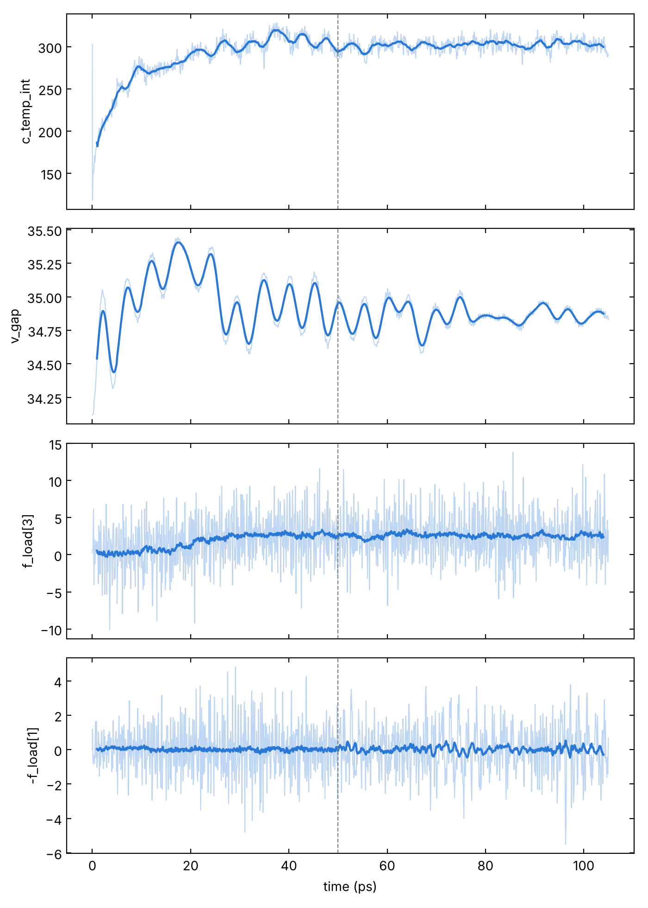
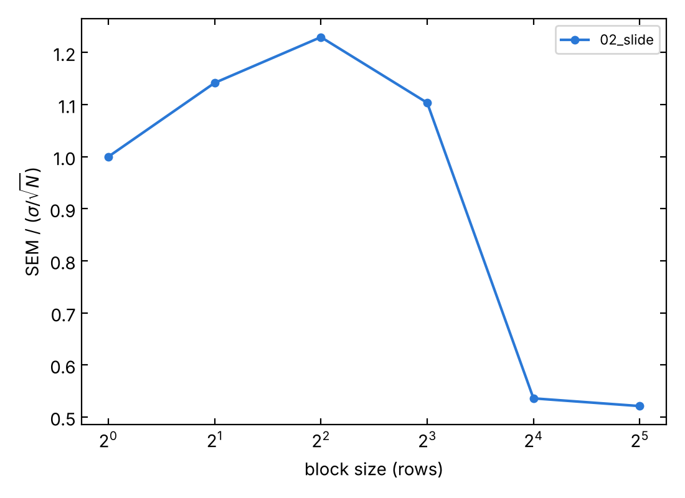
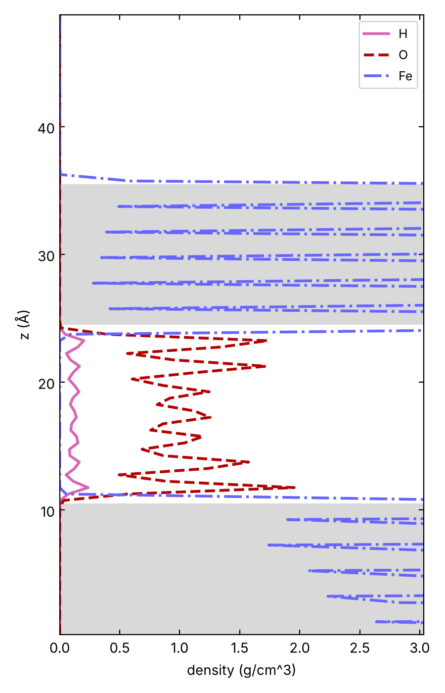
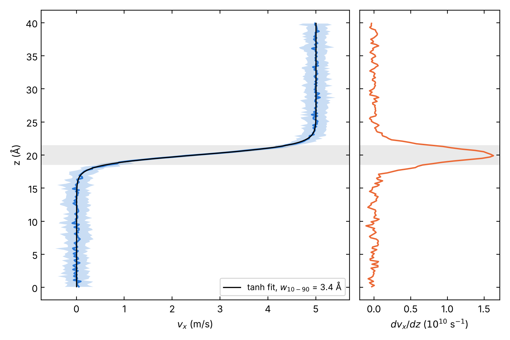
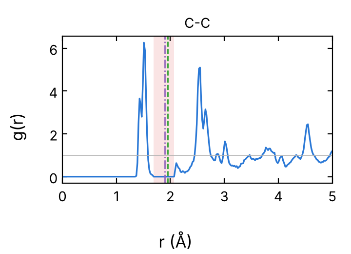
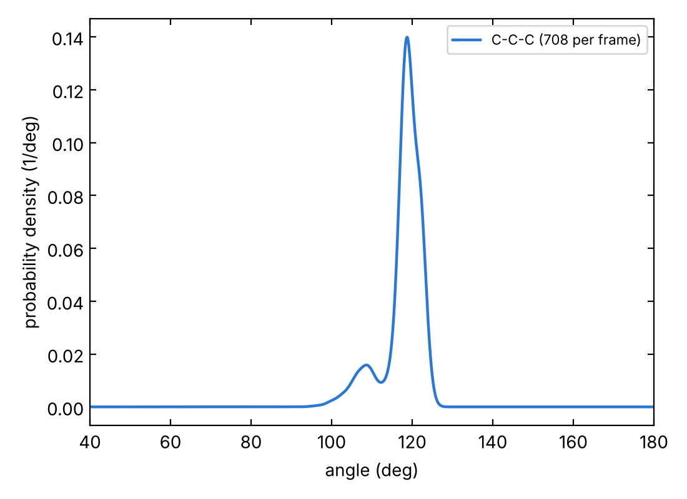
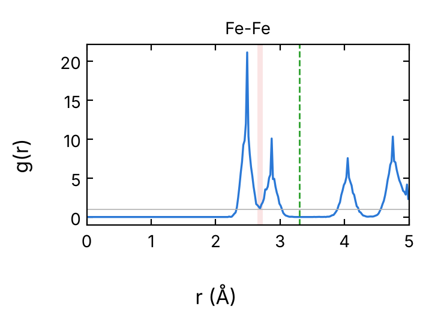
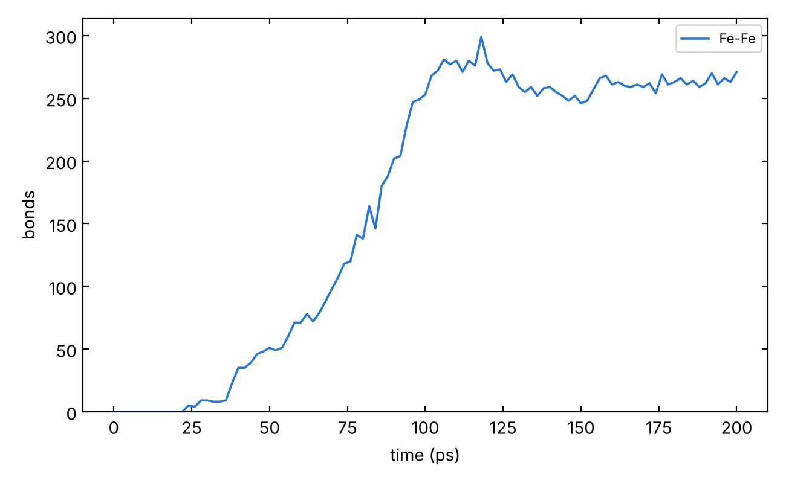
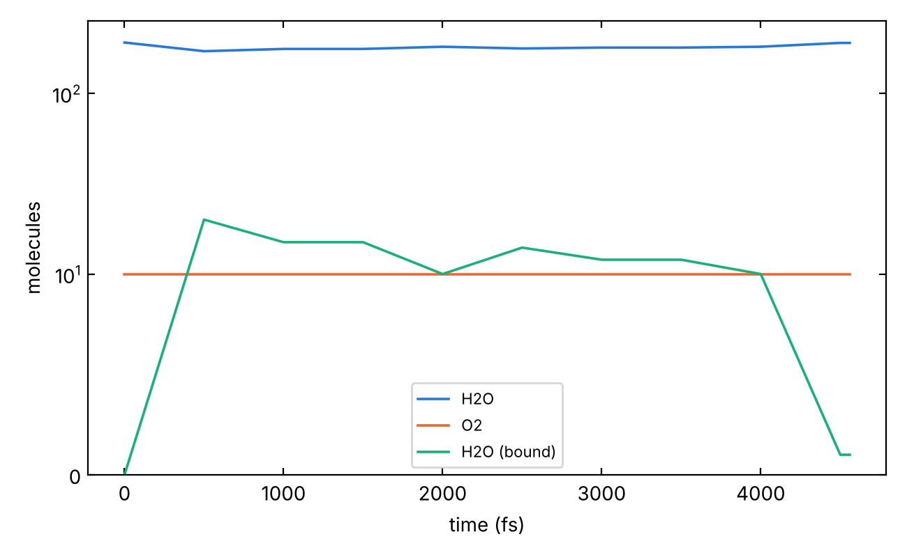

# Analysis of the LAMMPS runs

Scripts for the outputs of the templates in `../`: thermo logs (time
series, friction with error bars) and text dumps (density and velocity
profiles, local structure, bonds across an interface, detached atoms,
molecule counts). They run from any folder; `-h` prints the usage.

## Contents

| Script | Reads | Gives | OVITO |
|---|---|---|---|
| `thermo.py` | logs | columns and expressions vs time across stages; averages with error bars | no |
| `friction.py` | logs | friction stress τ, normal stress P, μ, with error bars; τ vs P for several runs | no |
| `zprofile.py` | dumps | density along z per element or group (also in `fix ave/chunk` format) | no |
| `vprofile.py` | dumps | v_x(z) from unwrapped positions, shear plane, width w10-90; overlays | no |
| `structure.py` | dumps | partial RDFs with a check of the bond cutoffs, coordination, bond angles | yes |
| `bonds.py` | dumps | bonds across an interface, direct and bridged, per nm² vs time | yes |
| `detached.py` | dumps | atoms detached from a body (wear) and their fragments vs time | yes |
| `species.py` | dumps | molecules by formula vs time, free or bound to a surface | yes |

In `tools/` also the shared modules (`lmp_io.py`: readers, time axis,
statistics; `ovito_io.py`; `cutoffs.py`: bond cutoffs). `tests/synthetic.py`
checks every script on synthetic data with known answers.
`reference/`: figures and printed output of the examples below.

## Setup

- All scripts: numpy, pandas, matplotlib, scipy, ase. Start from the
  shared environment of `../../leonardo/README.md` and `pip install` what
  is missing.
- `structure.py`, `bonds.py`, `detached.py`, `species.py` also need
  OVITO (`pip install ovito`; tested with 3.16.1). The environment
  `/leonardo/pub/userexternal/epedrett/.venv/mace` is the one of the
  OVITO scripts these come from; check it with `python -c "import ovito"`.
- After installing or updating: `python tests/synthetic.py` (31 checks,
  about 15 s; the OVITO ones are skipped without OVITO).
- The dump tools read every frame of the window: for long trajectories
  use `--every`, or run them in a job rather than on the login node.

## Conventions

- **Dumps** as written by the templates: `dump custom ... id element xu
  yu zu` with `dump_modify ... sort id`. Without `element`, give
  `--type-names Fe O H` (element of type 1, 2, ...). Without `id`, atoms
  are matched by row order: valid only with `sort id` and a constant
  number of atoms.
- **Several files** (stages, restarts) in chronological order on the
  command line. A pattern is expanded in natural order (`dyn2` before
  `dyn10`); the order of the arguments is kept. A frame written twice at a
  restart is counted once (the later copy).
- **Time.** Logs carry the timestep. Dumps do not: give `--dt` (one value
  per stage if they differ, in the time unit of the run, ps for `metal`).
  A `reset_timestep` starts a new stage; stages are laid end to end from
  t = 0 and the boundaries are dashed in the plots. Without `--dt` the dump
  tools use the step count.
- **Frames**: `--tmin/--tmax` (time as above), `--last N` (the last N
  frames of the window), `--every N`.
- **Atom selections** (`--side1`, `--track`, `--centres`): elements
  (`C+H+O`), id ranges (`1:500`), id lists (`1,5,9`) or the groups of the
  groups file written by `structures/` (`--groups file.groups.lmp`,
  names joined with `+`).
- **Bonds**: distance cutoffs per element pair, from `cutoffs.py`: a table
  at about 1.25 times the bond length (`compute_bonds.py`, E. Pedretti),
  with `--alternative` the values of `ovito_cho.py` for C-C, C-H, C-O,
  H-H; other pairs 1.25 times the sum of the covalent radii, printed as
  such. That last rule is wrong for metals (Fe-Fe 3.30 Å takes in the
  second neighbours of bcc Fe). Change any value with `--cutoff Fe-Fe:2.7`,
  and check the cutoffs with `structure.py` on your system before counting
  bonds.
- **Error bars**: standard error of the mean by blocking
  (Flyvbjerg-Petersen), integrated correlation time `tau_int` and
  independent samples `N_eff` = rows / `tau_int`. Below 20 independent
  samples the run is too short for the average.

## Examples

On the local checks of the templates (classical potentials, reduced
settings: see each README). They show what the scripts print and plot; the
numbers are not physical results. Logs from `../0*/reference/`; the dumps
are written by running the local checks. Full output in
`reference/commands_output.txt`.

### thermo.py: time series

```bash
python thermo.py 01_load.log 02_slide.log --list
python thermo.py 01_load.log 02_slide.log -c c_temp_int v_gap "f_load[3]" "-f_load[1]" --rolling 21 -o load_slide
python thermo.py 02_slide.log -c "-f_load[1]" "f_hold_bot[1]" v_gap --stats
```

`--list` prints the columns of every run. `-c` takes columns or
expressions of columns (quote them). Minimizations are left out
(`--minimize` keeps them). `--stats` gives, per stage, mean, standard
deviation, error of the mean, `tau_int` and `N_eff`, without the first
20 % of the stage (`--skip`) or before `--tmin`.



Load (0-50 ps) and sliding (from the dashed line, `reset_timestep 0` in
`02_slide.in`) of the local check of `05_sliding`: temperature of the
interface region, gap, normal and lateral force on `layer_top`, raw and
mean over 21 rows.

### friction.py: friction stress and coefficient

```bash
python friction.py 02_slide.log --force "-f_load[1]" --normal "f_load[3]" --data Fe_water_Fe.data
python friction.py load_*/02_slide.log --force "-f_load[1]" --normal "f_load[3]" \
    --data load_*/Fe_water_Fe.data --labels 1GPa 2GPa 5GPa -o friction_vs_load
```

τ = F/A and P = N/A in GPa, A = lx ly from the data file (or `--area`),
over the last stage of each log without its first 20 % (`--skip`) or
before `--tmin` (time from the start of the stage). The force is the
force of the system on the driven layer (`-f_load[1]`), or on the fixed
one (`f_hold_bot[1]`), or their mean `"0.5*(f_hold_bot[1]-f_load[1])"`:
in steady state they agree. With several logs: one row each in the csv
and τ vs P.

```
         label  rows          tau (GPa) tau_int  N_eff          P (GPa)              mu
      02_slide   441    0.0083 +- 0.0323     1.0    441   0.994 +- 0.059  0.008 +- 0.033
```

τ is zero within the error for the Lennard-Jones liquid of the local
check (`../05_sliding/README.md`).



Blocking curve: the error of the mean for growing block sizes, relative
to the uncorrelated estimate. A flat tail means the error bar has
converged; a curve still rising at the right end means the run is too
short and the error is a lower bound.

### zprofile.py: density profiles

```bash
python zprofile.py 01_load.lammpstrj 02_slide.lammpstrj --last 20 --mass --sigma 0.3 --shade Fe -o density
python zprofile.py 02_slide.lammpstrj --groups Fe_water_Fe.groups.lmp \
    --by-group surf_bot molecules surf_top --last 20 --avechunk
```

Number density per element (or per group with `--by-group`), in Å⁻³ or
g/cm³ (`--mass`), 0.5 Å bins, frames averaged as `fix ave/chunk ... norm
sample`; `--avechunk` also writes `dens_profile_<X>` in that format.
`--sigma` smooths the plot only. `--shade Fe` greys the slabs and sets the
x range on the film.



Last 20 frames of the local check of `05_sliding`: O and H of the liquid
between the Fe slabs (grey, peaks of the atomic planes cut).

### vprofile.py: velocity profile and shear plane

```bash
python vprofile.py 02_slide.lammpstrj --dt 0.0005 --tmin 10 -o vx
python vprofile.py --overlay 1GPa/vx.csv 5GPa/vx.csv --labels "1 GPa" "5 GPa" -o overlay
```

v_x of each atom is its displacement in `xu` between two frames `--lag`
apart over their time interval (no velocities in the dump needed),
binned in z (0.2 Å). Then a tanh fit (shear plane z0, half-width w), a
straight-line (Couette) fit over the sheared region, and the model-free
width w10-90 (z from 10 % to 90 % of the velocity drop; 2.20 w for a tanh,
0.80 h for a linear profile of thickness h). The shear is LOCALISED if
2w is below a quarter of the profile, else DISTRIBUTED; only the matching
fit is drawn. `--overlay` aligns profiles where v reaches 95 % of the drop
and writes their widths.

The local check of `05_sliding` (45 ps at 10 m/s in a Lennard-Jones
liquid) is too short for a profile: the tanh fit has R² = 0.32, w10-90 is
1.9 Å with the defaults and 10.2 Å with `--bin 0.5 --lag 5`, and the
script says so. Below, the synthetic profile of `tests/synthetic.py`
(tanh, z0 = 20 Å, w = 1.5 Å):



z0 = 20.01 Å, w = 1.49 Å, w10-90 = 3.37 Å (3.30 expected). Widths below
3 bins are not resolved: halve `--bin` and check.

### structure.py: RDF, cutoffs, coordination, angles

```bash
python structure.py meltquench.lammpstrj --last 10 --angles C-C-C -o aC
python structure.py 01_indent.lammpstrj -o Fe_check
```

Partial RDFs (OVITO, each partial tends to 1), averaged over the frames
(by default the last one). For each pair: the first peak, the valley
after it, the cutoff in use and the bonds per frame, with a flag when the
cutoff is outside the valley. Then the coordination (bonded neighbours
per atom) and, with `--angles A-B-C`, the angle at B. `--zmin/--zmax` or
`--centres` restrict the centre atoms of coordination and angles (e.g. the
film, not the substrate); the RDFs are of the whole system.

```
   pair  peak (A)  valley (A)  cutoff g(rc)/g(pk) bonds/frame
    C-C      1.51   1.69-2.07    1.95        0.00       334.0   (table)

   C (216 centres): mean 3.09   3: 90.7%  4: 9.3%
  C-C-C: 708 per frame, mean 117.8 deg, most frequent 118.8 deg
```

 

Amorphous carbon of the local check of `03_meltquench` (Tersoff): 91 %
threefold, 9 % fourfold carbon. Green dashed: cutoff in use; red band:
valley; purple: the other value of `cutoffs.py`.

The second command checks Fe-Fe: the covalent-radii rule gives 3.30 Å,
beyond the valley at 2.65-2.73 Å, so the bonds include the second
neighbours (14 per bulk atom). The next examples use `--cutoff Fe-Fe:2.7`.



### bonds.py: bonds across an interface

```bash
python bonds.py 01_indent.lammpstrj --side1 sub_top --side2 sub_bot \
    --groups Fe_tip_on_Fe.groups.lmp --cutoff Fe-Fe:2.7 --dt 0.001 --counts -o tip_slab
python bonds.py load.lammpstrj slide.lammpstrj --side1 C --side2 Si+N --bridge O \
    --dt 0.0005 --every 10 --rolling 5 -o C_SiN
```

Direct bonds between the two sides per element pair, and bonds bridged by
an atom of a `--bridge` element (A-X-B, counted once per path). Sides by
element follow `compute_bonds.py` (each element on one side only: C in
diamond, Si and N in the nitride); by ids or groups for anything else.
Densities per nm² of the cell area times `--interfaces` (2 if both
contacts of a periodic sandwich count); `--counts` plots counts (a tip
touches less than the cell).



Local check of `06_indentation` (EAM Fe): thermalization 0-20 ps,
approach 20-100 ps, hold 100-120 ps, retraction 120-200 ps. Bonds form
from contact at about 22 ps and 271 remain after the retraction: the
clean Fe tip stays welded to the slab.

### detached.py: wear

```bash
python detached.py dyn*.lammpstrj --track C+H+O --dt 0.0005 --every 10 -o asperity
python detached.py 01_indent.lammpstrj --track sub_top --groups Fe_tip_on_Fe.groups.lmp \
    --cutoff Fe-Fe:2.7 --dt 0.001 -o tip
```

The atoms of `--track` are clustered by their bonds among themselves; the
largest cluster at the first frame is the body (its composition is
printed: check it) and its atoms are followed (`--all-tracked`: all
tracked atoms). At each frame, detached = followed atoms outside the
cluster that holds most of them, per element, and the number of
fragments; the fragments of the last frame by formula in
`<out>_fragments.csv`. Only bonds among the followed atoms hold an atom
to the body; with `--connect C+H+O` the atoms of those elements also
connect (as in `ovito_cho.py`): an asperity atom bonded to the body only
through an adsorbed water O then counts as attached. On the Fe tip
above no atom detaches (0 in all frames); `tests/synthetic.py` checks the
counts on a block that loses an atom pair and an atom.

### species.py: molecules

```bash
python species.py highT.lammpstrj --track molecules --groups Fe_water.groups.lmp \
    --cutoff Fe-Fe:2.7 --dt 0.0005 -o water
```

Molecules = clusters of tracked atoms connected by bonds, counted by
formula; "(bound)" when one of their atoms is bonded to an untracked atom
(the surface). Also the tracked atoms bonded to the surface, per element.

```
             species   first    last     mean
                 H2O     191     190    181.0
                  O2      10      10     10.0
         H2O (bound)       0       1     10.0
```



Local check of `07_reactive` (ReaxFF, `units real`, so `--dt 0.25` fs and
`--units real` there): 191 H₂O and 10 O₂, some water bound to Fe during
the run. The free/bound split depends on the Fe-O cutoff (2.48 Å from the
covalent radii); `structure.py` flags it as cutting the Fe-O peak of this
system: set it from the RDF.

## Differences from the original scripts

The scripts started from E. Pedretti's (ovito-analysis and tribology
scripts); the choices that change numbers:

- `vprofile.py` (`compute_v_profile.py`, `overlay_profiles.py`): reads
  the text dump without OVITO; the analysis uses all bins with data (not
  the longest contiguous stretch, which breaks at the empty bins between
  crystal planes); the Couette region is where dv/dz has the sign of the
  velocity drop (|dv/dz| could pick a noise spike of the other sign), and
  it is printed only for distributed shear; R² of the tanh fit with a
  warning below 0.9.
- `zprofile.py` (`density_profile_from_dump.py`): elements or groups;
  `--shade` in place of the Fe slab detection.
- `structure.py` (`rdf_check.py`): the first-minimum estimate is widened
  to a valley and the cutoff is flagged when outside it.
- `detached.py` (`ovito_cho.py`): by default clusters among the followed
  atoms only; the original clusters all atoms of the selected elements, so
  an atom held to the body only through atoms outside it (e.g. an O of a
  water molecule bonded to both) counts as attached there and as detached
  here. `--connect C+H+O --alternative` reproduces the original.
- `bonds.py` (`compute_bonds.py`): sides also by ids or groups; any bridge
  element. Same counts with sides by element.
- `friction.py`, `thermo.py` (`friction_vs_load.py`): same blocking and
  `tau_int`, read from the logs directly.
