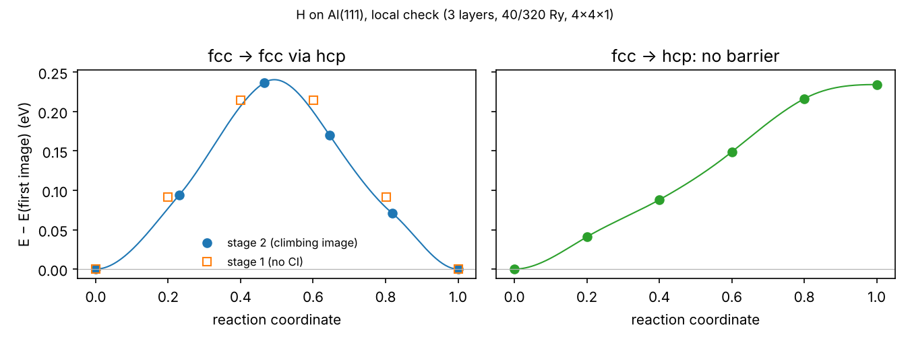

# 08 · Energy barriers with NEB

The nudged elastic band (NEB) method finds the minimum-energy path between
two stable structures and, at its highest point (the saddle point), the
energy barrier of the process: an atom hopping between two sites, a
reaction step, a molecule dissociating on a surface. This page explains
how a NEB calculation works and how to set it up (with a commented
template, `neb_template.pwi`), then runs an example: H diffusing on
Al(111).

## How NEB works

The path is represented by a chain of **images**: copies of the system
between the initial and the final structure, linked by springs. neb.x
computes energy and forces of every image with pw.x and moves the images
together: each one only perpendicular to the path (the forces along the
path are removed, the "nudging"), while the springs keep them evenly
spaced. At convergence the images lie on the minimum-energy path.

**What you need**

- **Initial and final structures, both relaxed**, with exactly the
  settings of the NEB: same pseudopotentials, cutoffs, k-points, smearing,
  cell. neb.x does not relax the end points: an unrelaxed end point gives a
  wrong barrier.
- **The same atoms in the same order** in the two structures. neb.x moves
  atom *k* of the initial structure onto atom *k* of the final one. If the
  order differs, atoms are dragged through each other and the path
  tangles. Example: the two H of a water molecule swapped in the final
  structure make both H cross the molecule, with a huge, meaningless
  barrier. Build both end points from the same structure and never sort or
  renumber one of them alone. Check: only the atoms you expect should move
  appreciably between the end points.
- Optionally, **intermediate images**: a guess of a structure the path
  passes through, when the straight line between the end points crosses a
  forbidden region (atoms too close).

**How to run it**

- **Two stages.** Stage 1 without climbing image (`CI_scheme = 'no-CI'`)
  and a loose threshold gives a rough path. Stage 2 restarts from it with
  `CI_scheme = 'auto'`: the highest image climbs to the saddle point, so
  its energy is the barrier. Starting with the climbing image on a bad
  path can send it to the wrong maximum.
- **Images.** `num_of_images` includes the two end points, which are
  computed only at the first step: 6 images = 4 moving images. More images
  give a finer path at a higher cost; 5-9 are typical.
- **Parallelization.** neb.x distributes the images over image groups
  (`-ni`). With as many groups as moving images, every GPU always has an
  image: 6 images → 4 moving → 1 node, `-ni 4` (`jobscripts/neb.sh`);
  10 images → 8 moving → 2 nodes, `-ni 8`. The number of MPI ranks must be
  a multiple of `-ni`.
- **Convergence.** `path_thr` (eV/Å) is the largest force perpendicular to
  the path. neb.x prints the barrier forward (`activation energy (->)`) and
  backward (`(<-)`) at every iteration.

## The input

`neb_template.pwi`, commented line by line. In short:

```
BEGIN
BEGIN_PATH_INPUT
&PATH ... /                 NEB settings
END_PATH_INPUT
BEGIN_ENGINE_INPUT
&CONTROL ... &SYSTEM ... &ELECTRONS ...   the pw.x input of the end points,
ATOMIC_SPECIES, K_POINTS, CELL_PARAMETERS  without positions
BEGIN_POSITIONS
FIRST_IMAGE
ATOMIC_POSITIONS ...        relaxed initial structure
INTERMEDIATE_IMAGE          (optional)
ATOMIC_POSITIONS ...
LAST_IMAGE
ATOMIC_POSITIONS ...        relaxed final structure, same atom order
END_POSITIONS
END_ENGINE_INPUT
END
```

`tools/make_neb.py` writes this file from two relaxed `.pwo` files: last
positions of each, cell and settings copied from the `.pwi` of the first,
check of the atom order. Use it rather than editing by hand.

## Example: H hopping between fcc sites on Al(111)

On Al(111) an adsorbed H atom sits in the fcc hollow site. It diffuses by
hopping to a neighbouring fcc site, passing near the hcp hollow between
them. The hcp site itself is not a minimum for H here: a relaxation keeps
H there only by symmetry, and a NEB fcc → hcp (tested locally) rises all
the way to hcp without a barrier. So the example goes fcc → fcc, with hcp
as intermediate image.

Needs the relaxed structures of 07 (clean slab, H on fcc and on hcp).
Two steps: `01_second_fcc` relaxes H on the neighbouring fcc site (the
second end point), `02_neb` runs the NEB.

### 1. Second end point

```bash
cd 01_second_fcc
python ../../tools/add_adsorbate.py ../../07_adsorption_h_al111/02_clean_slab/Al111_4L_2x2.pwo \
       H fcc --offset 1 0 --height 1.0
sbatch job.sh Al111_4L_2x2_H_fcc_10.pwi
```

`--offset 1 0` puts H on the same type of site one surface cell further
along a1: the fcc site 2.84 Å from the one of 07. Settings and atom order
are those of 07, because both inputs come from the same clean slab. Check:
the final energy equals that of the fcc run of 07 within ~1 meV, since the
two structures are equivalent.

### 2. Build the NEB input

```bash
cd ../02_neb
python ../../tools/make_neb.py ../../07_adsorption_h_al111/03_slab_h/Al111_4L_2x2_H_fcc.pwo \
       ../01_second_fcc/Al111_4L_2x2_H_fcc_10.pwo \
       --via ../../07_adsorption_h_al111/03_slab_h/Al111_4L_2x2_H_hcp.pwo --images 6
```

The first two arguments are the end points; `--via` adds the hcp structure
as intermediate image (the straight line between the two fcc sites passes
0.8 Å, in plane, from a top-layer Al atom). The script prints the largest
displacement of each segment: H, 1.64 Å. Open `neb.pwi` and compare it
with the template; look at the images with `qe2xyz neb.pwi`.

### 3. Stage 1 and stage 2

```bash
sbatch job.sh neb.pwi
```

When stage 1 has converged (`grep "neb: convergence achieved" neb.pwo`),
keep a copy (`cp neb.pwo neb_stage1.pwo`), edit three lines of `&PATH` in
`neb.pwi`:

```
restart_mode = 'restart'
CI_scheme    = 'auto'
path_thr     = 0.05
```

and resubmit in the same folder: `sbatch job.sh neb.pwi`. At the top of the
new `neb.pwo`, `restart_mode` must read `restart`: without `neb.path` in
the folder neb.x silently starts from scratch.

The first NEB step is the most expensive: every image starts its SCF from
scratch. Later steps start each image from its previous density.

### Output

| File | Content |
|---|---|
| `neb.pwo` | per NEB iteration: energy of each image and error (eV/Å) |
| `neb.dat` | reaction coordinate, energy relative to the first image (eV), error |
| `neb.int` | interpolated energy profile, for plots |
| `neb.axsf` | all images: `qe2xyz neb.axsf` to look at the path |
| `neb.path` | restart file |

```bash
grep "activation energy" neb.pwo | tail -2      # forward (->) and backward (<-) barrier
```

### Local check (reduced settings)

Run locally with 3 layers, 40/320 Ry and 4×4×1 k-points. They check the
procedure, not the barrier at the settings of this example:

| NEB | Result |
|---|---|
| fcc → hcp | energy rises monotonically up to E(hcp) − E(fcc) = 0.234 eV: hcp is not a minimum |
| fcc → fcc via hcp, stage 1 | symmetric profile, highest images 0.214 eV (on either side of the midpoint) |
| fcc → fcc via hcp, stage 2 | climbing image at 0.237 eV, near the midpoint; error still 0.08 eV/Å after 19 iterations (stopped) |

- The barrier is ≈ E(hcp) − E(fcc): the saddle point is at (or very close
  to) the hcp site.
- Stage 1 underestimates the barrier: its images are not at the top.
- With an even number of images no image sits at the midpoint of a
  symmetric path, and the climbing image has to travel there. An odd
  `num_of_images` (e.g. 7) starts one image at the midpoint, at the price
  of 5 moving images on 4 GPUs.



Files in `reference/` (fcc → fcc: last iteration of the unconverged
stage 2):

| File | Content |
|---|---|
| `neb_*.dat` | images: reaction coordinate, energy (eV), error (eV/Å) |
| `neb_*.int` | interpolated profile |
| `neb_*.axsf` | path as written by neb.x |
| `neb_*.extxyz` | the same path from `qe2xyz`, ready for OVITO/ASE |
| `neb_profiles.png` | the plot above |

## Checks

- Initial and final energies in `neb.pwo` equal those of the relaxations.
  Here the two end points are equivalent: equal energies, a symmetric
  profile, equal forward and backward barriers.
- Look at the path (`neb.axsf`): only the expected atoms move appreciably.
- An intermediate image lower than an end point: that end point was not a
  minimum. Relax that image and restart from it.
- neb.x prints `suggested k_max` and `suggested k_min` at the start;
  `make_neb.py` writes the QE defaults (0.1 a.u.). If the path does not
  converge, restart with the suggested values.

## Common problems

- neb.x stops at the start: the number of MPI ranks is not a multiple of
  `-ni`.
- `Error in routine d_matrix` at an intermediate image: the cell is not
  given at full precision (e.g. read back from a `.pwo`); see
  `troubleshooting.md`.
- Very slow first step: loosen the engine `conv_thr` for stage 1, tighten
  it for stage 2.
- The path does not converge (the error oscillates): lower `ds` to 0.5, or
  use more images.
- The whole slab drifts sideways along the path (visible in `neb.axsf`):
  fix the bottom layer in all the calculations (end points and NEB).
