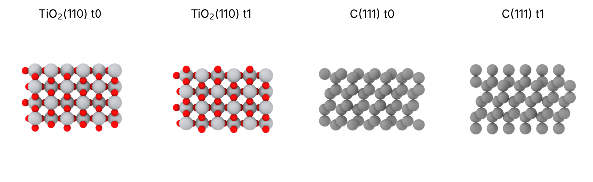

# 01 · Slabs of any crystal

A slab is a few layers of a crystal cut along a plane (hkl), periodic in
the plane and with vacuum along z. Compounds and high-index planes can be
cut in several ways: each cut gives a different termination, with its own
composition and surface energy. `tools/slab.py` builds all of them with
pymatgen `SlabGenerator`, so you can pick the one you need; elemental fcc,
bcc and hcp low-index slabs can also be built with ASE (`qe/tools/build_slab.py`).

You get one `.extxyz` per termination, with c along z, atoms sorted along z
and the vacuum you ask for. Bulk files: `../bulk/`.

## 1. List the terminations

```bash
python ../tools/slab.py ../bulk/TiO2_rutile.cif --miller 1 1 0 --layers 4 --list
```

```
t0 TiO_Pmmm_4: 24 atoms, 12 atomic planes, stoichiometric
    bottom plane O, top plane O2Ti2; ...
t1 O2_Pmmm_1: 24 atoms, 12 atomic planes, stoichiometric
    bottom plane O, top plane O; ...
```

- `--layers` is the thickness in unit planes (d_hkl). Rutile (110) has 3
  atomic planes per unit plane (O / Ti₂O₂ / O), hence 12 planes.
- The label (`O2_Pmmm_1`) is pymatgen's: species of the termination and
  its symmetry. The line below gives the composition of the outermost
  planes. t1 is terminated by bridging O on both sides: the usual
  rutile(110) slab. t0 has different top and bottom terminations.
- Check `stoichiometric`. A non-stoichiometric slab has a net excess of
  one species: surface energies from it need chemical potentials.

## 2. Write the slab

```bash
python ../tools/slab.py ../bulk/TiO2_rutile.cif --miller 1 1 0 --layers 4 --vacuum 15
python ../tools/slab.py ../bulk/TiO2_rutile.cif --miller 1 1 0 --layers 4 \
       --supercell 4 0 0 0 2 0 0 0 1 -f lammps-data --specorder Ti O
```

The first writes `TiO2_rutile_110_t0.extxyz` and `..._t1.extxyz`. The
second a 4×2 supercell (11.84 × 12.99 Å, 192 atoms) as LAMMPS data.
`--supercell` takes the 3×3 matrix by rows (ASE/pymatgen convention, new
vectors in units of the old ones; see `qe/06_slab_al111`, "Orthorhombic
cells").

## 3. Remove the extra planes

pymatgen may add planes so that top and bottom are compatible with the
bulk periodicity. In diamond (111) each unit plane is a bilayer (two
atomic planes 0.51 Å apart), and the slab can be cut between the two atoms
of a bilayer (3 dangling bonds per surface atom) or between bilayers (1
dangling bond):

```bash
python ../tools/slab.py ../bulk/C_diamond.cif --miller 1 1 1 --layers 4 --list
python ../tools/slab.py ../bulk/C_diamond.cif --miller 1 1 1 --layers 4 --keep-planes 8
```

The first prints 12 atomic planes for 4 layers. `--keep-planes 8` keeps the
lowest 8 (4 bilayers): t0 is 6.69 Å thick (3 × 2.06 Å + 0.51 Å, ends on
complete bilayers), t1 7.72 Å (ends inside bilayers). For the (111)
surface you usually want t0. Open both in OVITO and count the neighbours
of the surface atoms.



Side views (along x) of the two TiO₂(110) terminations (Ti grey, O red),
and of the diamond (111) slabs with 8 planes kept: t0 ends on complete
bilayers, t1 cuts them.

## 4. Orthorhombic cell for MD

Fe(110) comes out with an oblique cell (γ = 144.7°). Sliding needs an
orthorhombic one:

```bash
python ../tools/slab.py ../bulk/Fe_bcc.cif --miller 1 1 0 --layers 6
python ../../qe/tools/ortho_cell.py Fe_bcc_110_t0.extxyz --square 20
```

```
supercell matrix [[1,0,0],[4,3,0],[0,0,1]] x (8,3,1): 6 -> 432 atoms
orthorhombic cell 19.8562 x 21.0607 x 25.1328 A  -> Fe_bcc_110_t0_ortho.extxyz
```

`04_sliding_interface` uses this slab. The full outputs of the commands
above are in `reference/`.

## Notes

- **Bulk from the method you use.** Cut the slab from the bulk relaxed
  with the same DFT settings or MLIP, otherwise it starts strained.
- **Reconstructions.** pymatgen also has a `ReconstructionGenerator`
  (diamond 2×1, missing row, ...). With pymatgen 2026.9.24 it gave
  diamond slabs with 5-fold coordinated atoms, so `slab.py` does not use
  it. Build the reconstruction on the unreconstructed slab (supercell,
  then move the atoms) and relax it.
- `--symmetrize` makes top and bottom equivalent by removing atoms; check
  the stoichiometry afterwards.
