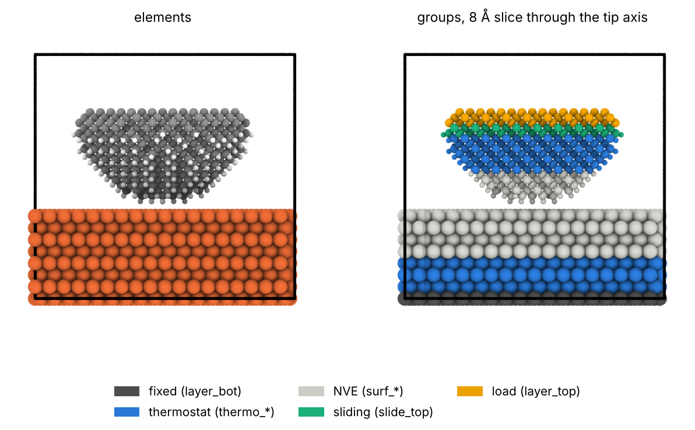

# 05 · Tip on a slab (single asperity)

A single asperity is modelled as a tip, here a hemisphere cut from a
crystal, pressed and slid on a slab. Use it for nanoindentation, scratch
and single-asperity wear. `tools/tip.py` cuts the hemisphere, flat face up,
apex down, and can passivate the curved surface with H and/or OH.
`tools/interface.py` puts the tip on the slab and writes the groups. The
load is given as a nominal pressure on the flat face.

## 1. The tip

```bash
python ../tools/tip.py ../bulk/C_diamond.cif --radius 15
python ../tools/tip.py ../bulk/C_diamond.cif --radius 15 --passivate H:1.0 -o C_tip_H.extxyz
python ../tools/tip.py ../bulk/C_diamond.cif --radius 15 --passivate H:0.5 OH:0.5 -o C_tip_HOH.extxyz
```

```
hemisphere R = 15.0 A: 1255 atoms (removed 36 with CN < 2); bulk CN 4
passivated 197 of 209 undercoordinated surface atoms with H (12 skipped: too close to others)
1452 atoms, C1255H197; box [50.612 50.612 35.338] A; flat-face area pi R^2 = 706.9 A^2
```

- Atoms left with fewer than 2 neighbours after the cut are removed.
- Undercoordinated atoms of the curved surface (CN below the bulk value,
  more than `--flat-skip 3` Å below the flat face) get one H or OH each,
  along the radial direction, at the sum of the covalent radii (C-H
  1.07 Å, C-O 1.42 Å, O-H 0.97 Å). Sites where the passivant would be
  closer than 1.4 × (sum of covalent radii) to another atom are skipped:
  with OH, 36 of 104 sites are skipped here.
- The fractions are of the undercoordinated sites, not of the atoms.
- Relax or thermalize the tip on its own before using it: the cut
  surface reconstructs.

## 2. Tip on the slab

The slab must be wider than the tip, or the tip interacts with its
periodic images. Here a 45 × 42 Å Fe(110) slab for a 30 Å wide tip:

```bash
python ../tools/slab.py ../bulk/Fe_bcc.cif --miller 1 1 0 --layers 8
python ../../qe/tools/ortho_cell.py Fe_bcc_110_t0.extxyz --square 45 -o Fe110_45.extxyz
python ../tools/interface.py Fe110_45.extxyz --top C_tip_H.extxyz --isolated-top \
       --fixed 2 --thermo 6 --top-fixed 2 --top-slide 2 --top-thermo 6 \
       --load 5.0 --load-area 706.9 --specorder Fe C O H -o tip_on_Fe.data
```

```
4044 atoms (2592 bottom, 0 middle, 1452 top), cell [44.6765 42.1214 42.024 ] A -> tip_on_Fe.data
group layer_bot   id <> 1 324
group thermo_bot  id <> 325 1296
group surf_bot    id <> 1297 2592
group surf_top    id <> 2593 2837
group thermo_top  id <> 2838 3514
group slide_top   id <> 3515 3727
group layer_top   id <> 3728 4044
...
variable    load_force equal -0.06959184172   # eV/A per atom: 5.0 GPa on 706.90 A^2, 317 atoms
```



Front view: elements (C grey, H white, Fe orange) and, on an 8 Å slice
through the axis of the tip, the groups.

- `--isolated-top` skips the lateral-cell check and centres the tip above
  the slab; the apex is `--gap 2.5` Å above the slab.
- From the flat face down: `layer_top` (2 Å, load, usually a rigid body
  in LAMMPS), `slide_top` (2 Å, moved for sliding), `thermo_top` (6 Å,
  thermostat), `surf_top` (the apex, NVE).
- `--load-area 706.9` (π R²): `--load 5.0` is the nominal pressure on the
  flat face. The real contact pressure at the apex is much higher and is
  not known in advance; report the normal force (eV/Å × atoms) together
  with the nominal value.

Checked in LAMMPS (`read_data`, `include`): `layer_top` spans z = 30.2-32.0
Å, `slide_top` 28.2-29.3 Å, `thermo_top` ends at 27.6 Å; the apex is at
16.69 Å, 2.5 Å above the slab (14.19 Å). Full outputs in `reference/`.

## Notes

- **Size.** R = 15 Å is a small tip for a test. The diamond-on-SiN
  nanoindentation runs of the group used R = 26 Å and about 6·10⁴ atoms.
- **Amorphous counter surface.** Use a melt-quenched slab (03 and the
  LAMMPS part) as bottom.
